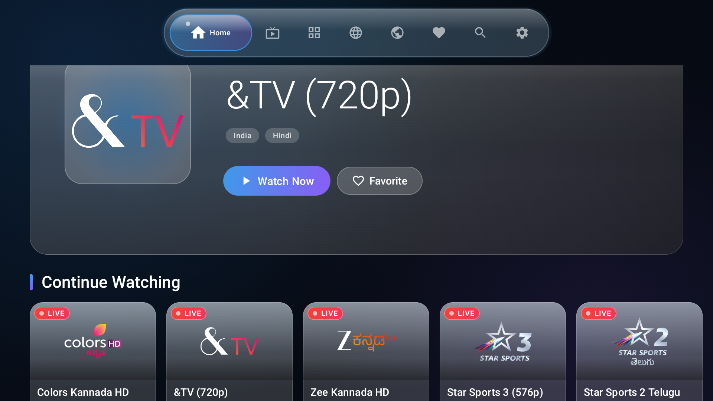
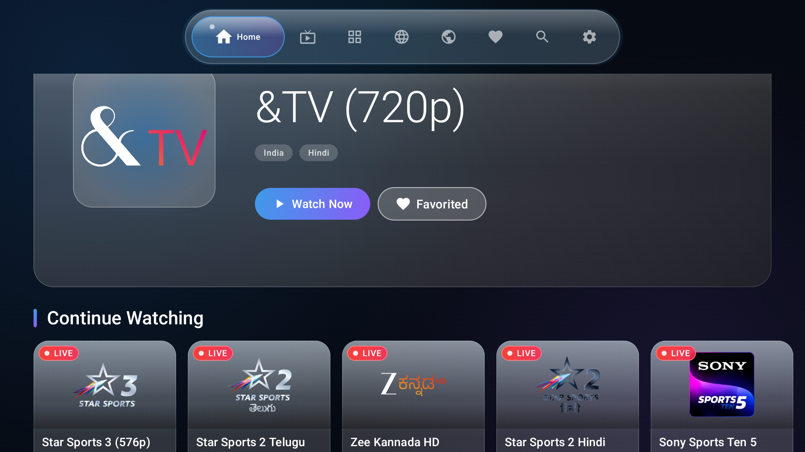
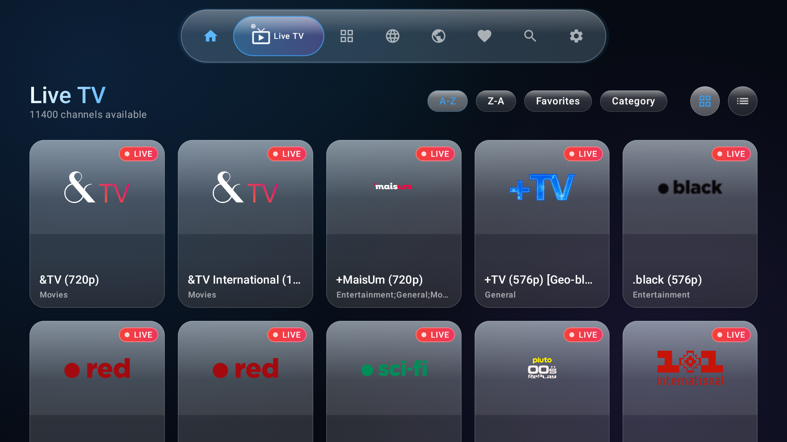
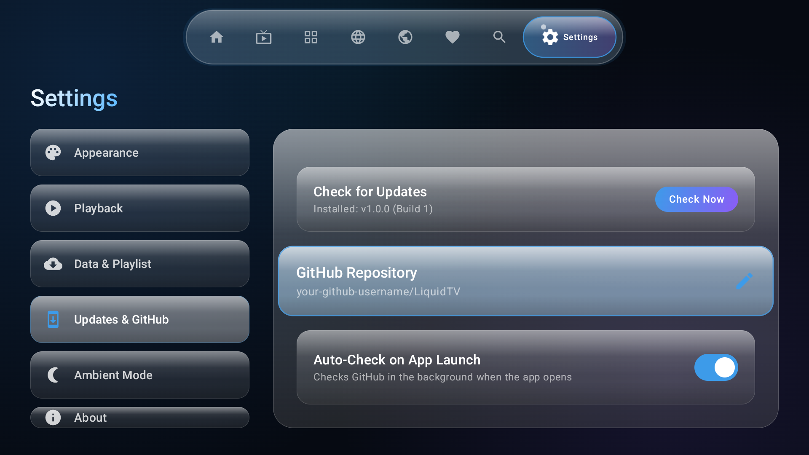

# 🌊 LIQUID TV — Open-Source Android TV IPTV Client

<p align="center">
  
</p>

<p align="center">
  <a href="https://github.com/manvithgkacharya/LiquidTV/releases/latest"></a>
  <a href="https://github.com/manvithgkacharya/LiquidTV/releases"></a>
  <a href="LICENSE"></a>
  <a href="https://developer.android.com/tv"></a>
</p>

---

## 📺 Overview

**LIQUID TV** is an ultra-modern, open-source live TV and IPTV streaming application meticulously engineered for **Android TV**, **Google TV**, and **Fire TV** devices.

Built from the ground up using **Jetpack Compose for TV** and **AndroidX Media3 (ExoPlayer)**, LIQUID TV delivers a next-generation **Liquid Glass** aesthetic—featuring real-time frosted glass cards, dynamic specular highlights, fluid D-pad spatial focus navigation, and automated GitHub In-App updates.

---

## 📸 Screenshots

| 🏠 Liquid Home Screen | 📂 Browse Categories |
| :---: | :---: |
|  |  |
| **Hero banner, quick watch & history** | **Smart category pills with live channel counts** |

| 🌐 Browse by Language | ⚙️ Updates & GitHub Settings |
| :---: | :---: |
|  |  |
| **Filter channels across worldwide languages** | **One-click manual check & custom repo configuration** |

---

## ✨ Features

- 💎 **Liquid Glass UI**: Ultra-clean glassmorphic surfaces with dynamic frosted blur, glowing cyan borders, and smooth TV focus elevations.
- ⚡ **ExoPlayer Media3 Live Streaming**: Low-latency HLS (`.m3u8`), TS, and MPD live stream playback with automatic reconnection, buffering indicators, and aspect-ratio scaling.
- 🧭 **100% D-pad Remote Control**: Designed strictly for 10-foot TV navigation without requiring a mouse or air remote.
- 🗂️ **Comprehensive Channel Discovery**:
  - **Category Browser**: News, Sports, Movies, Animation, Music, Entertainment, and more.
  - **Country & Language Filtering**: Instantly browse thousands of broadcast streams across regions.
  - **Live Search**: Rapid on-screen search with instant query filtering.
- ❤️ **Favorites & History**: Save preferred channels with one remote click and quickly resume from "Continue Watching".
- 🔄 **Automated In-App OTA Updater**:
  - Automatically queries GitHub Releases on startup.
  - Sleek glass update prompt with changelog and version badges (`v1.0.0 → v1.0.1`).
  - Real-time download progress bar.
  - Directly launches Android's native package installer on completion.

---

## 📥 How to Install on Android TV

### Method 1: Sideload via Downloader App (Easiest)
1. Install the **Downloader by AFTVnews** app from the Google Play Store on your Android TV / Google TV.
2. Open Downloader and enter the direct APK release link:
   ```text
   https://github.com/manvithgkacharya/LiquidTV/releases/latest/download/app-debug.apk
   ```
3. Once downloaded, click **Install** when prompted.

---

### Method 2: Wireless ADB Install (Developer / Power Users)
1. Enable **Developer Options** and **Wireless Debugging** (or Network ADB) on your Android TV:
   - *Settings → Device Preferences → About → Click "Build" 7 times.*
   - *Settings → Developer Options → Turn ON "USB debugging" and "Network debugging".*
2. Note your TV's IP address (e.g. `192.168.1.36`).
3. From your computer's terminal:
   ```bash
   adb connect 192.168.1.36:5555
   adb install -r app-debug.apk
   ```

---

### Method 3: USB Flash Drive
1. Download `app-debug.apk` from [Latest Releases](https://github.com/manvithgkacharya/LiquidTV/releases/latest) onto a USB drive.
2. Plug the USB drive into your Android TV.
3. Open any file manager on the TV (e.g., *File Commander* or *FX File Explorer*) and click the APK to install.

---

## 🛰️ IPTV Stream Sources & Attribution

LIQUID TV aggregates and loads live broadcast channels from open, community-curated playlists:
- **Primary Source**: [iptv-org/iptv](https://github.com/iptv-org/iptv) — An open-source collection of publicly available IPTV channels from across the globe.
- **Custom Playlists**: Users can configure any custom M3U or M3U8 playlist URL in **Settings → Playlist URL**.

### ⚖️ Legal Disclaimer
> [!IMPORTANT]
> **LIQUID TV does not host, provide, broadcast, or distribute any media content or video streams.**
> The application functions solely as an open-source media player interface capable of parsing user-provided M3U/M3U8 playlists and displaying publicly available live streams. The developers of LIQUID TV do not promote or condone copyright infringement. All channel logos, names, and trademarks belong to their respective copyright holders.

---

## 🛠️ Architecture & Tech Stack

LIQUID TV follows **Modern Android Development (MAD)** best practices:

- **Architecture**: Clean Architecture + MVVM + Unidirectional Data Flow (UDF)
- **UI Framework**: [Jetpack Compose for TV](https://developer.android.com/jetpack/androidx/releases/tv) (`androidx.tv:tv-material:1.0.0`)
- **Media Engine**: [AndroidX Media3 ExoPlayer](https://developer.android.com/media/media3) (`1.4.1`) with HLS extension
- **Dependency Injection**: [Hilt](https://dagger.dev/hilt/) (`2.51.1`)
- **Local Persistence**: [Room Database](https://developer.android.com/training/data-storage/room) with Kotlin Coroutines & Flow
- **Preferences**: [Jetpack DataStore](https://developer.android.com/topic/libraries/architecture/datastore)
- **Networking**: [OkHttp3](https://square.github.io/okhttp/) & [Retrofit2](https://square.github.io/retrofit/)
- **Image Loading**: [Coil Compose](https://coil-kt.github.io/coil/)
- **CI/CD Pipeline**: GitHub Actions for automated release APK generation

---

## 🏗️ Building from Source

### Prerequisites
- Android Studio Ladybug / Meerkat or later
- JDK 17
- Android SDK API Level 34+

### Clone & Build
```bash
# Clone the repository
git clone https://github.com/manvithgkacharya/LiquidTV.git
cd LiquidTV

# Build the Debug APK
./gradlew assembleDebug

# Output APK path:
# app/build/outputs/apk/debug/app-debug.apk
```

---

## 🤝 Contributing

Contributions, feature requests, and bug reports are warmly welcome!
1. Fork the Project.
2. Create your Feature Branch (`git checkout -b feature/AmazingFeature`).
3. Commit your Changes (`git commit -m 'Add some AmazingFeature'`).
4. Push to the Branch (`git push origin feature/AmazingFeature`).
5. Open a Pull Request.

---

## 📄 License

Distributed under the **MIT License**. See [`LICENSE`](LICENSE) for more information.

<p align="center">
  Crafted with ❤️ by <a href="https://github.com/manvithgkacharya">Manvith G K</a>
</p>
